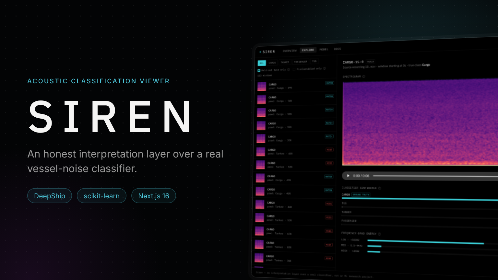
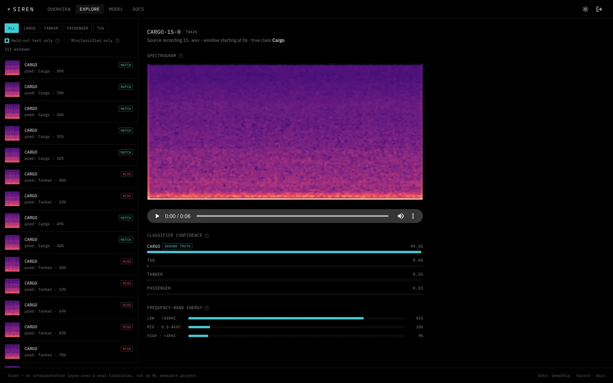
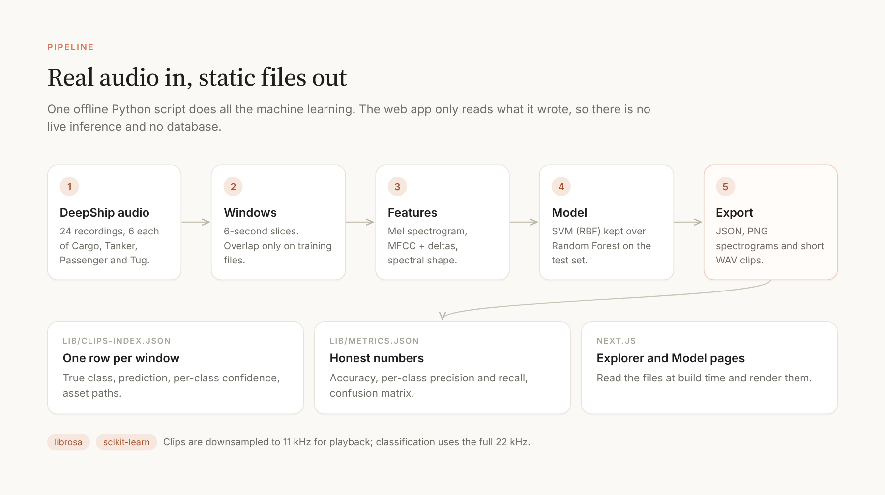
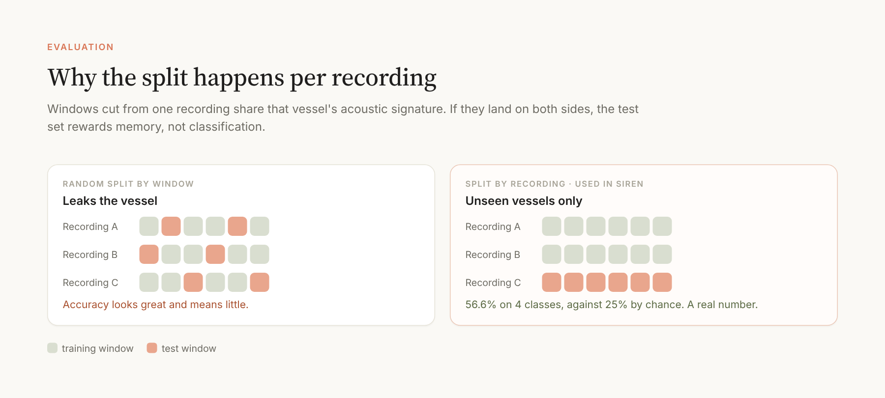
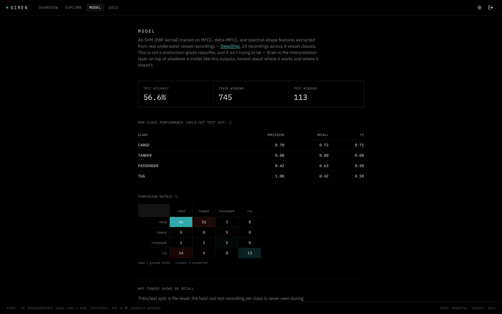

# Siren



**An interpretation layer over a real underwater vessel-noise classifier.** Named for the sirens of myth, known for their song, a fit for *acoustic* signatures. Real recordings of ships, a real and imperfect model, and an interface that helps an analyst read each prediction: what the model heard, how sure it was, and where it tends to be wrong.

Part of [Siegfried](https://github.com/joshrubio/Siegfried), a series of five satellite projects. Case study: [joshrubio.es/projects/siren](https://joshrubio.es/projects/siren)

This is deliberately **not** a machine-learning research project. The model is a small, honest baseline; the work is the UX layer on top of whatever a classifier like this outputs.



## What's real here

- **Audio**: 24 real recordings from [DeepShip](https://github.com/irfankamboh/DeepShip) (Jalkanen et al.), 6 per vessel class (Cargo, Tanker, Passenger, Tug), recorded in the Strait of Georgia, 2016-2018.
- **Features**: mel spectrograms, MFCCs, delta-MFCCs and spectral-shape descriptors (centroid, bandwidth, rolloff, zero-crossing rate, contrast), extracted with `librosa`.
- **Model**: an SVM (RBF kernel), kept over a Random Forest after comparing both on the held-out test set. **56.6% test accuracy** across 4 classes (vs. 25% by chance).
- **Evaluation**: the train/test split is done per *recording*, not per window, so no recording contributes windows to both sides.

## Pipeline



Everything (spectrograms, predictions, confidence scores, playback clips, metrics) is precomputed once by `scripts/preprocess.py` and shipped as static files: `lib/clips-index.json` (one row per window), `lib/metrics.json` and the images and clips in `public/`. No live inference and no database; the corpus is small enough that this is the right-sized choice.

### Why the split happens per recording



Windows cut from one recording share that vessel's acoustic signature. A random window split puts the same ship on both sides and inflates accuracy; splitting by recording gives a lower number that actually means something (the same concern the [UniqueShip paper](https://arxiv.org/abs/2609.13659) raises).

## The app

- **Explorer** (`/explore`): a master-detail view, filterable by class, held-out test windows only, or misclassified windows only. Each window shows its spectrogram (magma colormap, the field's convention), a player, per-class confidence and a frequency-band energy breakdown.
- **Model** (`/model`): accuracy, per-class precision/recall/F1 and a confusion matrix. Tanker sits at 0% recall, and the page explains why (too little vessel variation in training) instead of hiding it.
- **Docs** (`/docs`): what this is and isn't, and how the pipeline works.



## Identity

Benchmarked against iZotope RX's spectral editor and sonar waterfall displays: a near-black background, a cyan accent used only for functional signals, IBM Plex Sans/Mono and a tight instrument-panel radius.

## Running locally

```bash
npm install
npm run dev
```

No API keys are needed. The login page is a demo gate.

To regenerate the spectrograms, clips and metrics from scratch (requires the raw audio under `data/raw/<class>/*.wav`; see `scripts/preprocess.py` for the DeepShip subset used):

```bash
python -m venv .venv
.venv/Scripts/pip install librosa scikit-learn numpy soundfile pillow matplotlib
.venv/Scripts/python scripts/preprocess.py
```

## Stack

Next.js 16 (App Router, Cache Components) · TypeScript · Tailwind CSS v4 · shadcn/ui (`@base-ui/react`) for the app; Python (`librosa`, `scikit-learn`) for the offline pipeline.
